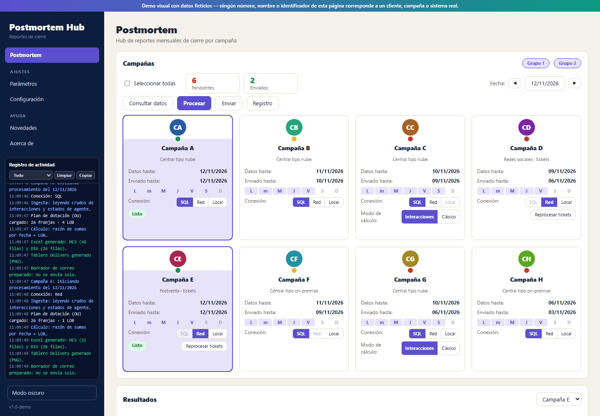
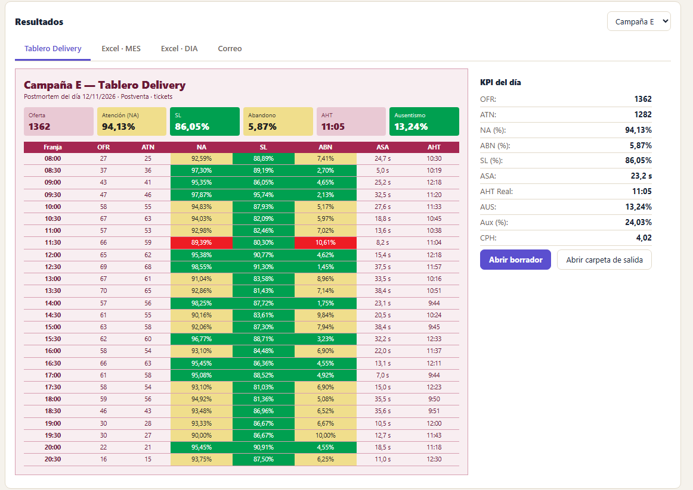
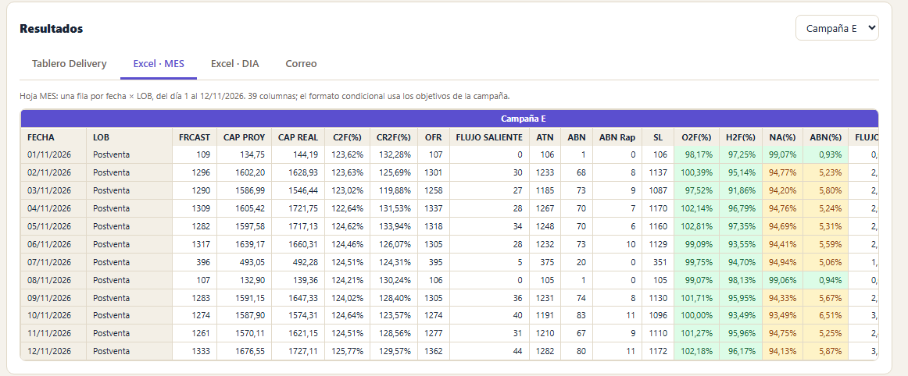
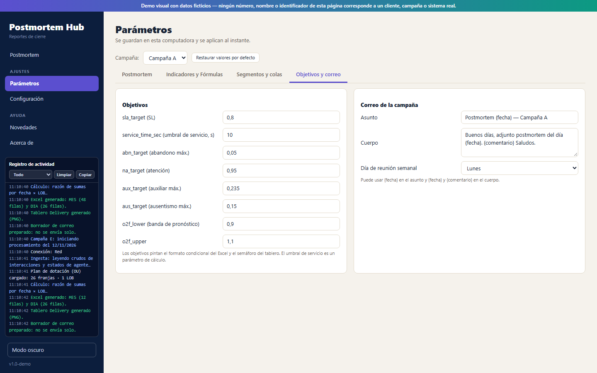
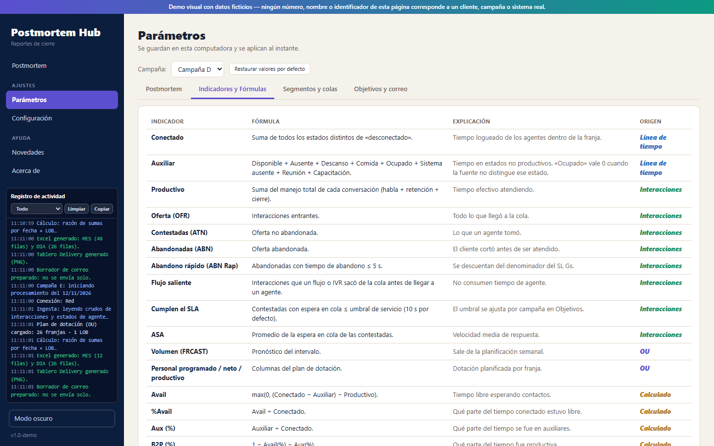
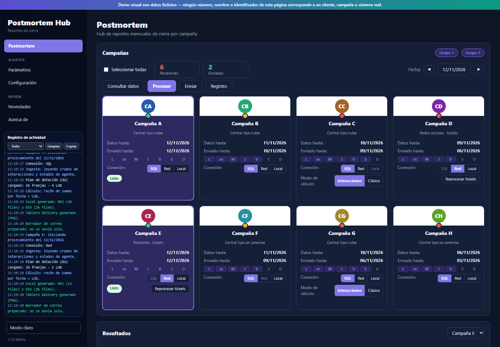

# Postmortem Hub — demo visual de un hub de reportes de cierre para contact center


> **Demo visual con datos ficticios.** Ningún número, nombre o identificador de este repositorio corresponde a un cliente, campaña o sistema real.

Maqueta navegable de un hub de **postmortem mensual** para varias campañas de contact center. El analista elige la fecha, procesa las campañas y obtiene tres entregables: un **tablero** para pegar en el correo, un **Excel** con las hojas `MES` y `DIA`, y un **borrador de correo** con un comentario analítico. El sistema nunca envía solo: siempre abre un borrador para que lo revise una persona.

Es un único archivo HTML: no tiene dependencias, no necesita instalación y no se conecta a ningún servidor.

**[Ver la demo en vivo](https://agonzalez-97.github.io/monthly-postmortem-demo/)**



## Qué muestra

**Hub de campañas**
- Ocho campañas ficticias (A a H) en dos grupos, de tres tipos: llamadas, redes sociales cerradas y postventa.
- Filtro por grupo (no se puede apagar el último), casilla «Seleccionar todas» y dos tiles, **Pendientes** y **Enviados**, que funcionan como filtro.
- Selector de fecha con flechas de mes y calendario, y los botones **Consultar datos**, **Procesar**, **Enviar** y un **Log** de ejecución.
- Cada tarjeta se selecciona con un clic en su bloque de identidad y muestra:
  - un **semáforo de «Datos hasta»** anclado al último día operativo: al día en verde, un día de atraso en amarillo, dos en rojo y más de dos en rojo titilante;
  - «Datos hasta» y «Enviado hasta», la fecha del último tablero realmente enviado;
  - una **leyenda semanal** `L m M J V S D` con un tooltip de la semana anterior y la actual, con el horario de cada LOB;
  - el selector de conexión (SQL, Red o Local), que se deshabilita con el motivo cuando falta configuración;
  - el modo de cálculo en las campañas que lo permiten, y el estado de la corrida.
- Una campaña sin roster corta de inmediato con un error claro, antes de calcular.

**Entregables**
- **Tablero Delivery**: cada campaña tiene una paleta propia derivada de un único color de marca, con semáforo de verde, amarillo y rojo.
- **Excel `MES` y `DIA`**: 39 columnas agrupadas en bandas, columnas de identificación fijas y formato condicional según los objetivos de la campaña.
- **Correo**: asunto y cuerpo desde una plantilla, el tablero incrustado y un comentario generado de forma local, con perfil «Estable» o «Nuevo (beta)».





**Parámetros por campaña** (los cambios se aplican al instante)
- **Postmortem**: alta, baja y renombre de LOB, mapeo de roster a LOB, destinatarios y opciones de cálculo según el tipo de campaña.
- **Indicadores y fórmulas**: cada indicador con su fórmula, una explicación breve y su origen (línea de tiempo, interacciones, calculado o plan de dotación).
- **Segmentos y colas**: asignación de cada cola a un LOB.
- **Objetivos y correo**: objetivos de SL, atención, abandono, auxiliar, ausentismo y banda de pronóstico, plantilla de correo y día de reunión semanal.
- Si cambia un parámetro de cálculo, los resultados ya procesados quedan marcados como **desactualizados** y se ofrece reprocesarlos.





También incluye **Configuración** (conexión, rutas, correo y comentario), **Novedades**, **Acerca de** y **tema claro y oscuro**.



## Cómo ejecutarla

Abrir `index.html` en cualquier navegador moderno. Como alternativa, servirla en local:

```bash
python -m http.server 8000
# luego abrir http://localhost:8000
```

Parámetros opcionales en la URL, útiles para enlazar una vista concreta:

| Parámetro | Ejemplo | Efecto |
|---|---|---|
| `v` | `#v=params` | Vista inicial: `hub`, `params`, `config`, `news` o `about` |
| `t` | `#v=params&t=obj` | Pestaña: `pm`, `ind`, `seg` u `obj` en Parámetros; `conexion`, `correo` o `camps` en Configuración |
| `c` | `#v=params&c=D` | Campaña elegida en Parámetros (`A` a `H`) |
| `rt` | `#rt=mes` | Pestaña de Resultados: `tablero`, `mes`, `dia` o `correo` |
| `th` | `#th=dark` | Tema: `light` o `dark` |
| `noauto` | `#noauto` | No procesa las campañas A y E al abrir |

## Stack

HTML, CSS y JavaScript sin librerías ni paso de compilación.

## Decisiones de diseño

- **Razón de sumas.** Todos los porcentajes son suma de numeradores sobre suma de denominadores, nunca un promedio de porcentajes.
- **Un objetivo por regla.** Los objetivos de cada campaña pintan el formato condicional del Excel y el semáforo del tablero.
- **Resultados como instantáneas.** Cada corrida guarda el resultado con los parámetros de cálculo que usó; si cambian, se avisa en lugar de recalcular en silencio.
- **Semáforo con texto y color.** El estado de «Datos hasta» no depende solo del color: la tarjeta también dice la fecha y el atraso en días operativos.
- **Datos reproducibles.** Los datos salen de un generador pseudoaleatorio con semilla por campaña, LOB, fecha y franja.

## Límites de la demo

Todo es simulado. Lo que en el sistema real toca el disco, la red o el correo (abrir carpetas, probar la conexión, enviar) solo muestra un aviso o abre un borrador de ejemplo: la página no descarga ni lee archivos, no abre correos, no usa ninguna IA real para el comentario y no hace ninguna petición de red. Los parámetros se guardan en el navegador (`localStorage`) y se pueden restaurar.

## Autor y licencia

Maqueta creada por Axel Hernán González. Reconstruye con datos ficticios la experiencia de un sistema de postmortem mensual que, en su versión real, se desarrolló en equipo.

Licencia [MIT](LICENSE).
